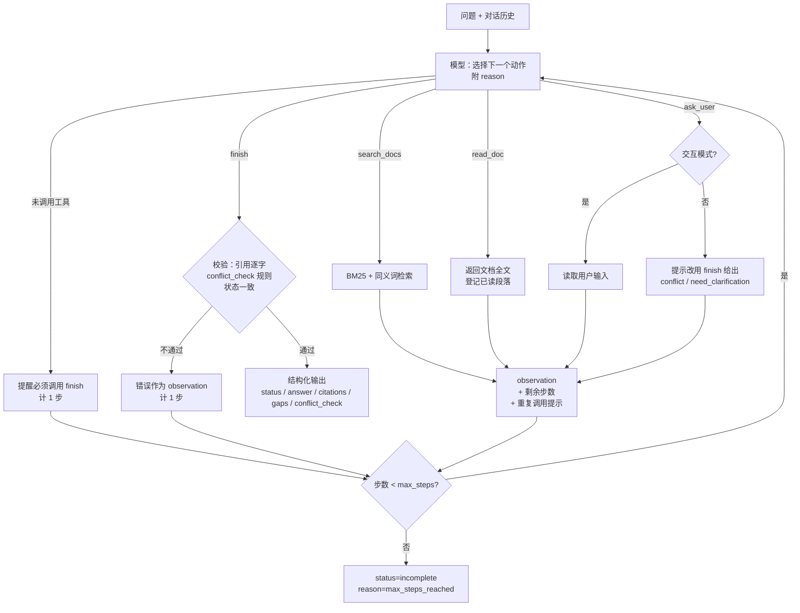

# 02 方案：调用流程、动态决策、技术取舍

## 模块

| 文件 | 职责 |
|---|---|
| `src/kb.py` | 解析 Markdown 文档（元数据头 + 段落），段落编号 P1…Pn |
| `src/retrieval.py` | jieba 分词，自实现的 BM25（段落级），同义词扩展 |
| `src/tools.py` | 工具 schema、`KnowledgeBase`（检索 / 读取）、`ToolRunner`（一次运行的状态、故障注入、ask_user、finish 校验） |
| `src/agent.py` | system prompt 和 ReAct 循环（步数上限、剩余步数、重复调用提示） |
| `src/llm.py` | OpenAI 兼容接口，temperature=0，API 层重试 |
| `src/mock_llm.py` | 脚本化 Mock 模型和每个用例的动作序列 |
| `src/trace.py` | trace（JSONL + Markdown） |
| `src/cli.py` | 命令行：单问题、按用例、交互多轮 |
| `scripts/run_eval.py` | 批量评测；`scripts/eval_retrieval.py` 检索评测；`scripts/smoke_llm.py` 模型连通性检查 |

## 调用流程



## ReAct 循环与动态决策

- 每一步由模型通过 tool calling 选择动作，并在 `reason` 参数中写一句决策依据（记入 trace，不要求内部思维链）。
- 程序执行工具后，把结果作为 observation 交回模型，由模型决定补充检索、读取原文、追问、换工具重试或结束。程序不包含"如果冲突就……"之类的固定分支。
- **步数上限**：默认 `max_steps=10`（`--max-steps` 可改）。每次工具调用算 1 步，被拒绝的 finish 和未调用工具的纯文本回复也各算 1 步。达到上限时返回 `status=incomplete, reason=max_steps_reached`。
- **循环防护（只提供信息，不替模型决策）**：每个 observation 附"剩余步数"；与之前完全相同的调用（工具名和参数相同）照常执行，并注明"与第 N 步调用相同"，结果也相同时注明"结果未变"。
- 同一个用例可以走出完全不同的路径，例子见 [examples/README.md](../examples/README.md#两条明显不同的执行路径)：C01 是 3 步直接回答；C03 是读三份文档，finish 被拒后改为冲突，共 6 步。

## 工具设计

| 工具 | 参数 | 返回 |
|---|---|---|
| `search_docs` | `query`、`top_k`（1–10，默认 5）、`reason` | 段落级结果：doc_id、标题、版本日期、适用范围、段落编号、片段、分数；无命中时附提示 |
| `read_doc` | `doc_id`、可选 `paragraph_ids`、`reason` | **总是返回全文**；`paragraph_ids` 只标注为 `requested_paragraphs`，不存在的段落列为 `missing_paragraphs` |
| `ask_user` | `question`、`reason` | 交互模式读取用户输入；批量模式返回提示，请模型以 conflict_need_confirmation 或 need_clarification 结束 |
| `finish` | `status`、`answer`、`citations`、`gaps`、`conflict_check`、`reason` | 校验通过则结束；否则把全部问题一次性作为 observation 返回 |

工具出错时返回 `{"error": {"type", "message"}}`，不抛异常，由模型决定下一步。

## finish 校验

### 引用

- `quote` 必须是对应段落原文的逐字片段（只忽略空白差异，标点、全半角都不放宽），至少 8 个字。
- 引用的段落必须在**本次运行中**由 `read_doc` 返回过（只被检索命中不算）。
- `answered` 至少 1 条引用；`conflict_need_confirmation` 至少 2 条来自不同文档的引用。
- 引用的 `title`、`version_date` 由程序按 doc_id 补充，不采用模型给出的值。

**逐字校验只能证明引用的原文存在，不能证明它支持回答。**

### conflict_check（必填）

```json
{
  "claims": [{"doc_id": "D01", "claim": "费用发生之日起30天内提交", "scope_quote": "未说明"}, ...],
  "relations": [{"docs": ["D01", "D02"], "type": "true_conflict", "basis": null}, ...]
}
```

- `claims`：本次 read_doc 读过的每份文档都要列出；与问题无关时 claim 写"与问题无关"；scope_quote 是声明适用范围的原文，没有则写"未说明"。
- `relations`：claim 不是"与问题无关"的文档，两两都要有一条关系。type 取值：consistent / scope_split / superseded / priority / true_conflict。

校验规则：

1. claims 必须覆盖本次读过的全部文档。
2. 相关文档两两必须有 relation（检查缺失的文档对）。
3. scope_split / superseded / priority 必须有 basis，basis 要通过与引用相同的逐字校验，并且来自这两份文档之一。
4. scope_split 时两份文档的 scope_quote 不能都是"未说明"；不是"未说明"的 scope_quote 必须逐字存在于该文档（适用范围字段或正文段落）。
5. 存在 true_conflict 时，status 必须是 conflict_need_confirmation。

**已知限制**：程序无法判断 claim 或 basis 在语义上是否成立。例如把不同结论标成 consistent，或者拿一句适用范围说明当作 priority 的依据，校验都拦不住，需要人工审核 trace。实测见 [03-evaluation.md](03-evaluation.md)。

## 两类失败的处理

| | 工具失败（检索 / 读取报错） | 模型调用失败（超时、连接错误、429） |
|---|---|---|
| 谁处理 | 模型 | 程序（API 层） |
| 方式 | 错误作为 observation 交给模型，由模型决定换参数重试、换工具，或以 failed 结束并说明缺口 | `src/llm.py` 短暂等待后重试 1 次；仍失败时 agent 返回 `status=failed, reason=llm_error`。401、400 等错误不重试。openai SDK 自带的自动重试已关闭（`max_retries=0`） |
| 原因 | 工具失败是 Agent 需要应对的业务情况，属于动态决策的一部分 | 模型不可用时无法让模型决策，只能在传输层重试 |

故障注入：`--fail-tool search_docs|read_doc`，`--fail-times N`（前 N 次失败；不填表示每次都失败）。

## 技术取舍

- **原生实现，不用框架**：核心循环（`run_agent`）约 60 行，每一步做什么都在代码里看得见；校验、故障注入、trace 都直接写在循环和工具里，不需要适配框架的抽象。代价是没有现成的记忆、并发、可视化等能力，本项目用不到。
- **BM25 + 同义词，不用 embedding**：只有 10 份短文档，BM25 在开发集、留出集上的 recall@3 都已是 1.000；embedding 会多一个依赖或 API，结果也更难解释。同义词扩展在实测中**没有可测量的收益**（三种模式的 recall@1 / recall@3 / MRR 完全相同，降权只是把排序问题从 R04 挪到了 R03），保留它，但不把它当作改进点。见 [03-evaluation.md](03-evaluation.md#检索评测)。
- **read_doc 总是返回全文**：v1 中模型总是只请求命中的那一段，因此看不到写在其他段落的适用范围、优先级、废止说明，把可查证的表面冲突当成真冲突。返回全文后，模型至少能看到这些信息。**限制**：只适合短文档。文档变长后会占用大量上下文，需要改为按章节返回，或返回"命中段 + 元数据 + 同文档中含适用 / 优先 / 废止关键词的段落"。
- **结构化 conflict_check + 程序校验，而不是只靠 prompt**：v3 中 prompt 已明确写了冲突核对步骤，两个模型仍把 D01 / D02 的冲突当作答案（并列或只取较新的一份）。v4 改为要求模型逐份写出结论和两两关系，再由程序校验"true_conflict 与 status 一致""范围分工必须有原文依据"等。gpt-4o-mini 的 C03、C04 因此由 0/3 变为 3/3。
- **脚本化 Mock**：Mock 按固定序列行动，不看观察结果。它的作用是在没有模型时验证循环、校验、故障注入和 trace，不证明决策效果；其中包含一条"故意错误引用"和一条"错误标 scope_split"的序列，用来验证校验会把错误交回模型。

## 默认模型

**默认模型为 gpt-4o-mini**（`.env.example` 中的 `AGENT_MODEL`；`--model` 可临时切换，不修改 .env）。

选择理由：在最终版本（v4）中，gpt-4o-mini 通过率 41/48，gpt-4.1 只有 24/48。

**gpt-4.1 的已知限制**：在 v4 中有 25 次运行撞到步数上限，原因是过度核实。它会反复重读同一文档、检索"适用范围"，看到"与第 N 步调用相同，结果未变"的提示也不停止。推测是 conflict_check 要求每份读过的文档都填适用范围，gpt-4.1 因此认为必须找到适用范围的原文。另一方面，gpt-4.1 在冲突识别上更准确（C06 3/3，C03 / C04 完成的运行关系全部标对），见 03。

## 配置

`.env`（参考 `.env.example`）：`AGENT_MODEL`、`AGENT_API_KEY`、`AGENT_BASE_URL`。不配置时可以用 `--mock` 离线运行。
